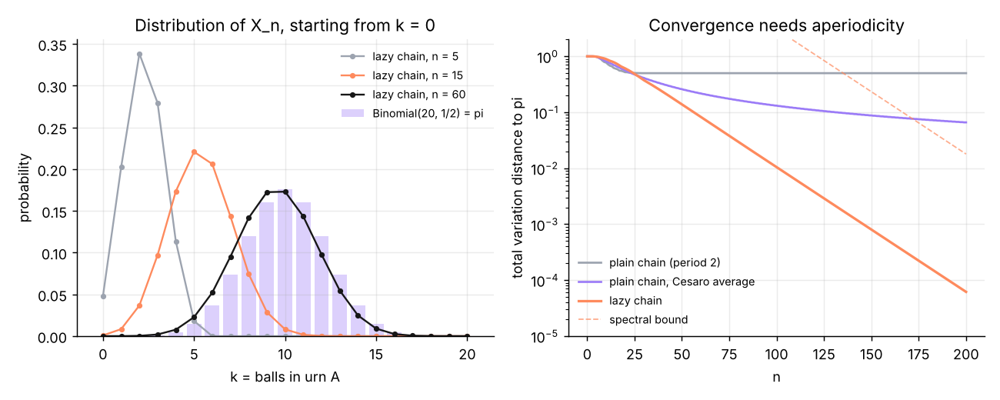
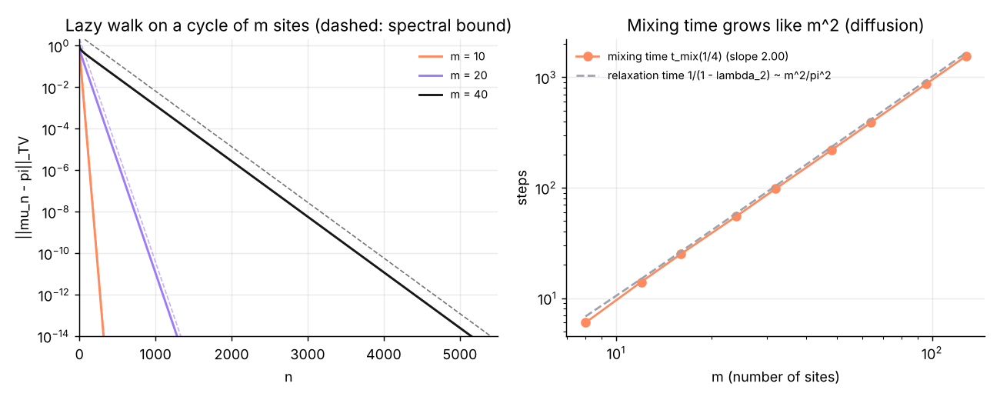
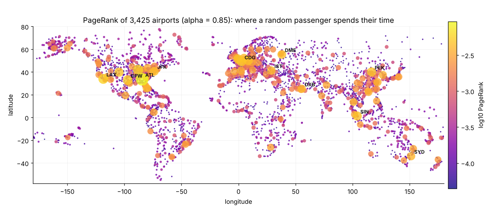
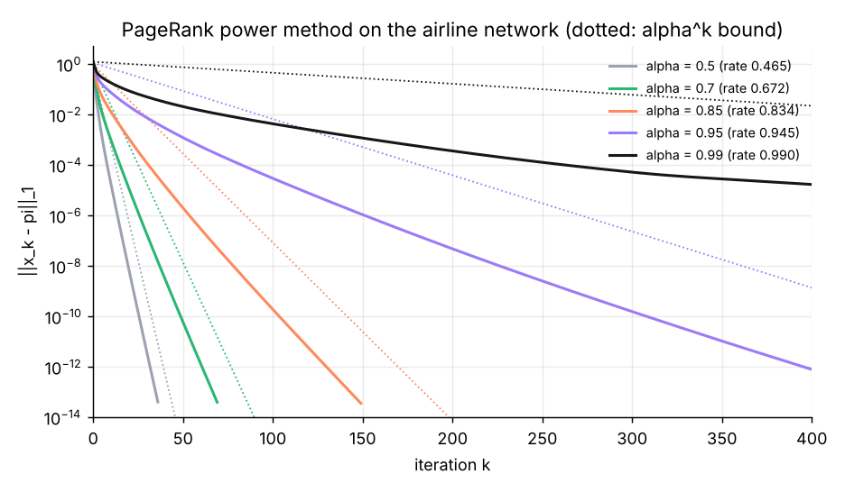
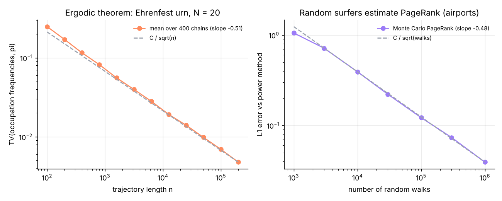

# Chaînes de Markov et PageRank


*English summary: [README_EN.md](README_EN.md)* · **Rapport complet (LaTeX) : [report/rapport.pdf](report/rapport.pdf)**

Projet personnel en Python (NumPy, Matplotlib). J'ai programmé les outils de base des chaînes de Markov finies et l'algorithme **PageRank**, puis **vérifié expérimentalement les résultats théoriques** : vitesse de convergence donnée par la deuxième valeur propre, temps de mélange, convergence en $1/\sqrt n$ des méthodes de Monte-Carlo, contraction en $\alpha^k$ de la méthode de la puissance. PageRank est appliqué au **réseau aérien mondial** (3 425 aéroports, 37 594 liaisons) et validé contre NetworkX (utilisé uniquement pour cette comparaison).

## 1. Loi stationnaire : trois méthodes

Urne d'Ehrenfest à $N = 20$ boules (la loi stationnaire exacte est la binomiale $\mathcal B(N, 1/2)$, démontrée par l'équilibre détaillé) :

| Méthode | Erreur max. | Coût |
|---|---|---|
| Système linéaire $\pi(P - I) = 0$, $\sum \pi_i = 1$ (élimination de Gauss écrite à la main) | $1{,}9 \times 10^{-16}$ | – |
| Itération de la puissance (chaîne paresseuse) | $1{,}5 \times 10^{-14}$ | 297 itérations |
| Simulation : fréquences d'occupation (théorème ergodique) | $7{,}2 \times 10^{-4}$ | 1 000 000 pas |

La chaîne d'Ehrenfest est de **période 2** : $\mu_n$ ne converge pas (la masse oscille entre états pairs et impairs), alors que sa version paresseuse $\frac12(I + P)$ converge géométriquement.



## 2. Vitesse de convergence et trou spectral

Pour une chaîne réversible, $\lVert P^t(x,\cdot) - \pi\rVert_{TV} \le \frac12\sqrt{\frac{1-\pi(x)}{\pi(x)}}\,\lambda_\star^t$ (démonstration dans le rapport par le théorème spectral dans $\ell^2(\pi)$). Le taux mesuré coïncide avec la valeur propre théorique :

| Chaîne | $\lambda_\star$ théorique | Taux mesuré | Temps de mélange $t_{mix}(1/4)$ |
|---|---|---|---|
| Marche paresseuse sur un cycle, $m = 10$ | 0,904508 | 0,904508 | 10 |
| Cycle, $m = 20$ | 0,975528 | 0,975528 | 38 |
| Cycle, $m = 40$ | 0,993844 | 0,993844 | 152 |
| Ehrenfest paresseuse, $N = 50$ | 0,980000 | 0,980001 | 120 |

Sur le cycle, $\lambda_\star = \cos^2(\pi/m) \approx 1 - \pi^2/m^2$ : le temps de mélange croît comme $m^{2{,}00}$ (comportement diffusif).



## 3. PageRank sur le réseau aérien mondial

Un passager prend indéfiniment un vol au hasard depuis l'aéroport où il se trouve (avec probabilité $\alpha = 0{,}85$), ou recommence son voyage d'un aéroport quelconque : PageRank est la proportion du temps qu'il passe dans chaque aéroport, c'est-à-dire la loi stationnaire de la matrice de Google $G = \alpha S' + (1-\alpha)\mathbf 1 v^\top$.

- **Implémentation creuse** : on ne forme jamais $G$ ; une itération coûte $O(\text{nombre d'arcs})$. Convergence en 169 itérations, environ trois fois plus vite que NetworkX ; **écart maximal avec NetworkX : $6{,}6 \times 10^{-13}$**.
- **Convergence démontrée** : $\lVert x_k - \pi\rVert_1 \le \alpha^k \lVert x_0 - \pi\rVert_1$, d'où un critère d'arrêt garanti. Le graphe ayant 7 classes fermées (petits réseaux régionaux isolés), $|\lambda_2(G)| = \alpha$ exactement (Haveliwala et Kamvar) : la borne est la vraie vitesse.

| Rang | Aéroport | PageRank (×1000) | Rang par nombre de vols entrants |
|---|---|---|---|
| 1 | ATL Atlanta | 9,312 | 1 |
| 2 | ORD Chicago | 5,861 | 2 |
| 3 | LAX Los Angeles | 5,654 | 6 |
| 4 | DFW Dallas-Fort Worth | 5,375 | 8 |
| 5 | CDG Paris | 4,943 | 5 |
| 6 | LHR Londres | 4,942 | 4 |
| 7 | SIN Singapour | 4,816 | 12 |
| 8 | PEK Pékin | 4,811 | 3 |
| 9 | DEN Denver | 4,754 | 14 |
| 10 | FRA Francfort | 4,516 | 7 |

PageRank n'est pas le simple nombre de liaisons (corrélation de Spearman 0,807) : les aéroports d'**Alaska** (Anchorage, Fairbanks, Bethel) gagnent des centaines de places, car un passager qui entre dans ce réseau régional dense y reste longtemps. **Alger (ALG)** est au rang 139 sur 3 425.



| $\alpha$ | Taux mesuré | Itérations pour une erreur $< 10^{-10}$ | Garanti par la borne |
|---|---|---|---|
| 0,50 | 0,4654 | 26 | 33 |
| 0,85 | 0,8343 | 104 | 142 |
| 0,95 | 0,9449 | 308 | 451 |
| 0,99 | 0,9900 | 1 597 | 2 311 |



## 4. Monte-Carlo

Deux estimateurs par simulation, tous deux en $1/\sqrt n$ comme prévu :

- **Théorème ergodique** (400 chaînes d'Ehrenfest simulées en parallèle) : pente mesurée $-0{,}51$.
- **PageRank par marches aléatoires** : comme $\pi = (1-\alpha)\,v^\top\sum_k \alpha^k S'^k$, le point d'arrivée d'une marche qui s'arrête avec probabilité $1-\alpha$ à chaque pas suit exactement la loi $\pi$. Pente mesurée $-0{,}48$ ; avec un million de marches, les dix premiers aéroports sont exactement retrouvés.



## Structure

```
markov/
  linalg.py      élimination de Gauss avec pivot partiel
  chain.py       lois, loi stationnaire (3 méthodes), simulation, période, irréductibilité, temps de mélange
  models.py      chaînes à réponse connue : deux états, urne d'Ehrenfest, marche sur un cycle
  pagerank.py    PageRank (puissance creuse, Monte-Carlo), composantes fortement connexes (Kosaraju)
  airports.py    chargement du réseau OpenFlights
experiments/run_all.py   toutes les expériences : figures/, results.md et report/generated.tex
report/rapport.tex       rapport LaTeX (11 pages, valeurs numériques générées automatiquement)
tests/                   26 tests : stationnarité, spectres, période, borne spectrale, accord avec NetworkX…
data/                    réseau aérien OpenFlights (licence ODbL, voir data/README.md)
```

## Utilisation

```bash
pip install -r requirements.txt
python experiments/run_all.py              # régénère figures, résultats et tableaux du rapport (~1 min)
pytest                                     # lance les 26 tests
cd report && pdflatex rapport.tex && pdflatex rapport.tex
```

## Pistes

PageRank personnalisé, algorithme HITS, méthodes de Monte-Carlo par chaînes de Markov (Metropolis–Hastings), accélération de la méthode de la puissance (Gauss–Seidel, extrapolation).

## Auteur

**Yassine Abderrezak Dache**, licence d'informatique (USTHB) · [GitHub @yassinedache](https://github.com/yassinedache) · Code sous licence MIT · Données OpenFlights sous licence ODbL
